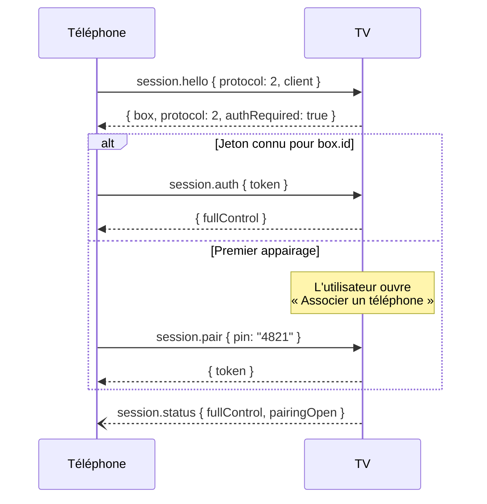

# API locale HomeHub — protocole v2

> Statut : **spécification v2 (cible V3)**. La V2 utilise le protocole v1 décrit en [annexe](#annexe--protocole-v1-legacy).
> Décision : [ADR-0003](../adr/0003-protocole-json-rpc-websocket.md). Sécurité : [ADR-0004](../adr/0004-appairage-et-securite.md).

## 1. Transport

| Élément | Valeur |
|---|---|
| Transport | WebSocket (RFC 6455), trames texte UTF-8 |
| URL | `ws://<adresse-tv>:<port>/homehub` (port par défaut **8765**) |
| Format | [JSON-RPC 2.0](https://www.jsonrpc.org/specification), un objet par trame |
| Sens | Bidirectionnel : le téléphone appelle la TV ; la TV envoie des notifications (événements) |
| Taille maximale d'une trame | 256 Kio |
| Débit maximal | 50 messages/s par session (au-delà : erreur `3001`) |
| Maintien | Ping WebSocket toutes les 15 s ; session fermée après 45 s sans trafic |

### Découverte

La TV publie un service DNS-SD :

| Champ | Valeur |
|---|---|
| Type | `_homehub._tcp` |
| Nom | `HomeHub · <nom de la box>` |
| TXT `id` | Identifiant stable de la box (UUID) |
| TXT `proto` | Versions de protocole acceptées, ex. `1,2` |
| TXT `path` | Chemin WebSocket, ex. `/homehub` |

## 2. Enveloppes

**Requête** (attend une réponse) :

```json
{ "jsonrpc": "2.0", "id": 42, "method": "app.launch", "params": { "package": "com.netflix.ninja" } }
```

**Réponse** :

```json
{ "jsonrpc": "2.0", "id": 42, "result": { "launched": true } }
```

**Erreur** :

```json
{ "jsonrpc": "2.0", "id": 42, "error": { "code": 2001, "message": "Application non installée", "data": { "package": "com.netflix.ninja" } } }
```

**Notification** (pas de réponse) — utilisée pour les touches répétées et tous les événements TV → téléphone :

```json
{ "jsonrpc": "2.0", "method": "card.action", "params": { "surfaceId": "search-1", "cardId": "tmdb:157336", "actionId": "open" } }
```

Règles :
- Les `id` sont choisis par l'émetteur (entier ou chaîne), uniques par session.
- Un champ inconnu est **ignoré** (jamais une erreur) : c'est ce qui permet au téléphone et à la TV d'évoluer à des rythmes différents.
- Les noms de méthodes suivent `domaine.action` ; les événements `domaine.évènement` au singulier.

## 3. Session et authentification



Avant authentification, seules `session.hello`, `session.auth`, `session.pair` et `session.ping` sont acceptées ; toute autre méthode renvoie `1001`.

### `session.hello`

| Paramètre | Type | Description |
|---|---|---|
| `protocol` | entier | Version demandée (2) |
| `client.id` | chaîne | Identifiant aléatoire du téléphone (UUID, aucun identifiant matériel) |
| `client.name` | chaîne | Nom affiché sur la TV, ex. « Pixel 8 » |
| `client.version` | chaîne | Version de HomeHub Remote |

Résultat :

```json
{
  "protocol": 2,
  "authRequired": true,
  "box": { "id": "5f0c…", "name": "Mi Box", "model": "MIBOX3", "sdk": 28, "version": "0.3.0" },
  "capabilities": ["cards", "widgets", "notifications", "input.fullControl"]
}
```

`capabilities` annonce ce que cette TV sait faire : le téléphone adapte ses commandes (ex. pas de `widgets.update` si absent).

### `session.auth`

| Paramètre | Type |
|---|---|
| `token` | chaîne (64 caractères hexadécimaux) |

Résultat : `{ "fullControl": true }`. Erreur `1006` si le jeton est inconnu ou révoqué (le téléphone l'oublie et propose l'appairage).

### `session.pair`

| Paramètre | Type |
|---|---|
| `pin` | chaîne de 4 chiffres affichée sur la TV |

Résultat : `{ "token": "…" }`. Erreurs : `1002` appairage fermé, `1003` code incorrect, `1004` trop d'essais (nouveau code affiché).

### `session.ping`

Résultat : `{}`. Utile pour mesurer la latence applicative.

## 4. Méthodes

### 4.1 Entrées — `input.*`

| Méthode | Paramètres | Résultat |
|---|---|---|
| `input.key` | `key` : touche (voir tableau), `action` : `press` (défaut), `down`, `up` | `{ "applied": true }` |
| `input.text` | `text` : chaîne, `mode` : `replace` (défaut) | `{ "applied": true }` |

Touches : `UP`, `DOWN`, `LEFT`, `RIGHT`, `CENTER`, `BACK`, `HOME`, `PLAY_PAUSE`, `NEXT`, `PREVIOUS`, `REWIND`, `FAST_FORWARD`, `VOLUME_UP`, `VOLUME_DOWN`, `MUTE`.

`input.key` peut être envoyé en **notification** pour les répétitions (aucune réponse attendue). Erreurs : `2002` contrôle complet requis, `2003` aucun champ de saisie.

### 4.2 Applications — `app.*`

| Méthode | Paramètres | Résultat |
|---|---|---|
| `app.list` | — | `{ "apps": [{ "package", "label", "favorite", "tv" }] }` |
| `app.icon` | `package`, `size` (px, défaut 128) | `{ "png": "<base64>" }` |
| `app.launch` | `package` | `{ "launched": true }` |
| `app.open` | `package` (facultatif), `intent` : `view` · `search` · `playFromSearch`, `uri`, `query` | `{ "opened": true, "fallback": "launched" }` |

`app.open` essaie l'intention demandée puis se replie sur l'ouverture simple de l'application ; `fallback` indique ce qui a réellement été fait. C'est la méthode derrière `playMusic()` (`intent: "playFromSearch"`) et l'ouverture d'un résultat de recherche (`intent: "view"`).

### 4.3 Cartes — `cards.*`

Une **surface** est un ensemble de cartes affiché sur la TV (panneau de réponse, grille de résultats…).

| Méthode | Paramètres | Résultat |
|---|---|---|
| `cards.show` | `surface` (objet ci-dessous) | `{ "shown": true }` |
| `cards.update` | `surfaceId`, `patch` | `{ "updated": true }` |
| `cards.dismiss` | `surfaceId` | `{ "dismissed": true }` |

```json
{
  "id": "search-1",
  "layout": "results",
  "title": "Interstellar",
  "state": "loading",
  "cards": [],
  "ttlMs": 120000
}
```

| Champ | Valeurs |
|---|---|
| `layout` | `answer` (panneau de réponse), `results` (grille), `focus` (une carte en grand), `loading` |
| `state` | `loading`, `thinking`, `streaming`, `done`, `error` |
| `ttlMs` | Durée d'affichage sans interaction (absent = jusqu'à fermeture) |

`patch` : `state`, `title`, `appendCards`, `replaceCards` (par `id`), `bodyAppend` (texte ajouté à la carte `answer`, pour l'affichage en flux d'une réponse IA).

Schéma d'une carte :

| Champ | Type | Obligatoire |
|---|---|---|
| `id` | chaîne | oui |
| `kind` | `answer` · `web` · `video` · `music` · `app` · `person` · `weather` · `widget` · `notification` | oui |
| `title` | chaîne | oui |
| `subtitle`, `body` | chaîne | non |
| `image` | `{ "url" \| "png", "ratio": "16:9" \| "2:3" \| "1:1" }` | non |
| `badges` | chaînes | non |
| `actions` | `[{ "id", "label", "command": { "method", "params" } }]` | non |

Une action de carte ne peut référencer qu'une méthode publique de cette API. Un `kind` inconnu est rendu par la carte générique.

### 4.4 Widgets — `widgets.*`

| Méthode | Paramètres | Résultat |
|---|---|---|
| `widgets.update` | `widget` : `{ "id", "kind", "card", "expiresAt" }` | `{ "updated": true }` |
| `widgets.remove` | `id` | `{ "removed": true }` |

La TV met en cache la dernière carte de chaque widget (affichage sans téléphone) et grise un widget expiré.

### 4.5 Notifications — `notifications.show`

| Paramètre | Type |
|---|---|
| `id` | chaîne |
| `title` | chaîne |
| `body` | chaîne (facultatif) |
| `priority` | `low` · `normal` · `high` |
| `durationMs` | entier (défaut 5000) |
| `actions` | comme les cartes (facultatif) |

### 4.6 Interface — `ui.*`

| Méthode | Paramètres | Résultat |
|---|---|---|
| `ui.navigate` | `destination` : `home` · `allApps` · `settings` | `{ "navigated": true }` |
| `ui.toast` | `message`, `kind` : `info` · `success` · `error` | `{}` |

### 4.7 Réglages — `settings.*`

| Méthode | Paramètres | Résultat |
|---|---|---|
| `settings.get` | — | `{ "accent", "wallpaper", "cardSize", "remoteEnabled" }` |
| `settings.set` | sous-ensemble des champs ci-dessus | réglages complets après modification |

## 5. Événements (TV → téléphone)

| Événement | Paramètres | Quand |
|---|---|---|
| `session.status` | `fullControl`, `pairingOpen` | Après authentification et à chaque changement |
| `card.action` | `surfaceId`, `cardId`, `actionId` | L'utilisateur active une action de carte **sans commande attachée** (le téléphone décide) |
| `cards.dismissed` | `surfaceId`, `reason` : `user` · `timeout` · `replaced` | Une surface disparaît |
| `tv.foreground` | `package` | L'application au premier plan change (contrôle complet requis, utilisé pour le contexte des intentions) |

## 6. Erreurs

| Code | Signification |
|---|---|
| `-32700` | JSON illisible |
| `-32600` | Requête invalide |
| `-32601` | Méthode inconnue |
| `-32602` | Paramètres invalides |
| `-32603` | Erreur interne |
| `1001` | Session non authentifiée |
| `1002` | Appairage fermé sur la TV |
| `1003` | Code d'appairage incorrect |
| `1004` | Trop d'essais, nouveau code affiché |
| `1005` | Version de protocole incompatible |
| `1006` | Jeton inconnu ou révoqué |
| `2001` | Application non installée |
| `2002` | Contrôle complet requis |
| `2003` | Aucun champ de saisie actif |
| `2004` | Capacité non prise en charge par cette TV |
| `3001` | Débit dépassé |

## 7. Versionnage et compatibilité

- La version majeure du protocole (`protocol`) ne change qu'en cas de rupture ; une TV annonce dans le TXT DNS-SD toutes les versions qu'elle accepte.
- Au sein d'une version : on peut **ajouter** méthodes, champs, valeurs d'énumération, événements ; on ne peut **ni retirer ni renommer**.
- Chaque ajout est signalé par une **capacité** dans `session.hello` pour que le téléphone ne l'utilise qu'avec une TV qui la connaît.
- Toute modification de cette page s'accompagne d'une fixture JSON dans `core/testing/fixtures/` et d'un test de contrat.

## 8. Tester à la main

```bash
# Ouvrir une session avec websocat (https://github.com/vi/websocat)
websocat ws://192.168.1.20:8765/homehub
{"jsonrpc":"2.0","id":1,"method":"session.hello","params":{"protocol":2,"client":{"id":"dev","name":"Terminal","version":"dev"}}}
{"jsonrpc":"2.0","id":2,"method":"session.pair","params":{"pin":"4821"}}
{"jsonrpc":"2.0","id":3,"method":"app.launch","params":{"package":"com.netflix.ninja"}}
```

## Annexe : protocole v1 (legacy)

Utilisé par HomeHub 1.1.0 / Remote 1.0.0 (V2). Retiré en V4.

- TCP brut sur le port 8765, un objet JSON par ligne, champ `t` pour le type.
- Téléphone → TV : `hello`, `auth`, `pair`, `key`, `voice`, `text`, `launch`, `apps`, `icon`, `ping`.
- TV → téléphone : `info`, `welcome`, `pairing`, `paired`, `result`, `apps`, `icon`, `status`, `error`, `pong`.
- Différence majeure : le message `voice` envoie la phrase brute, interprétée **par la TV**. En v2, la TV ne reçoit plus que des commandes.

Référence d'implémentation : `protocol/src/main/java/com/homehub/protocol/MessageCodec.kt`.
