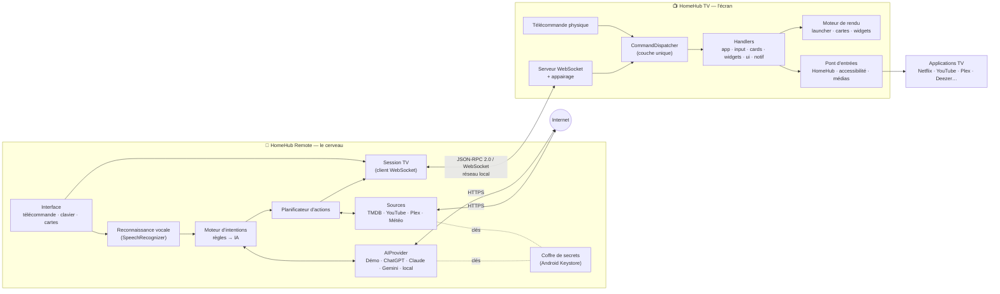
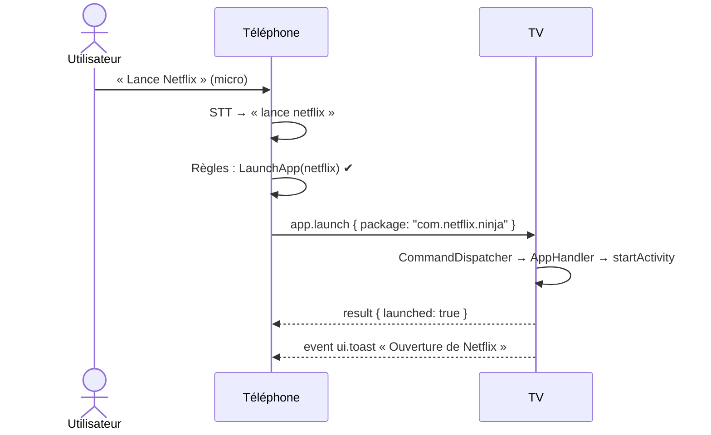
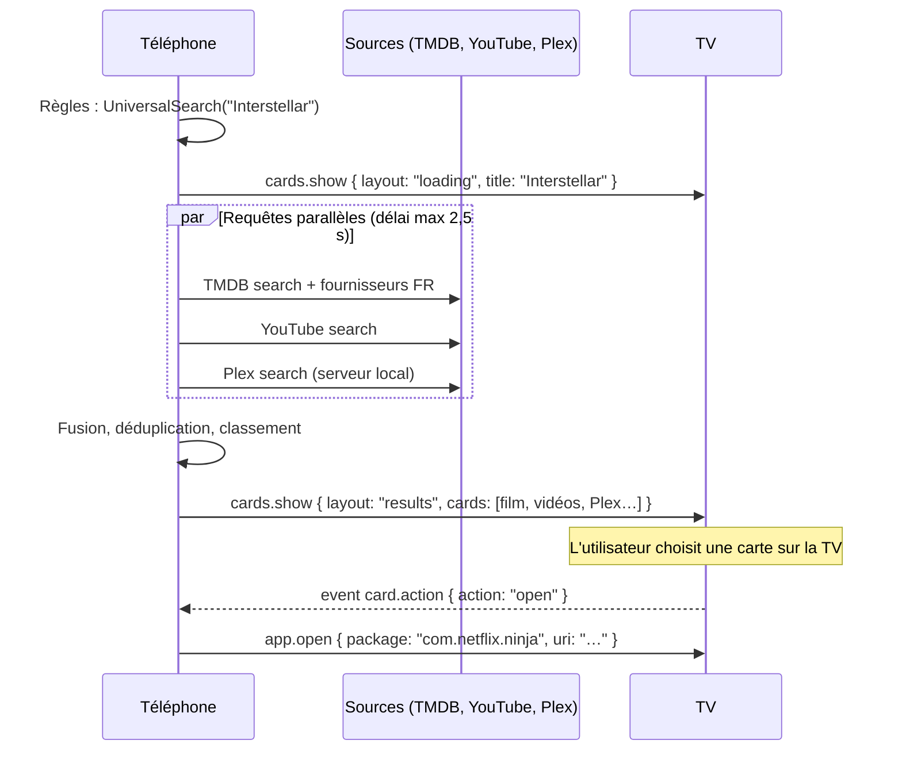
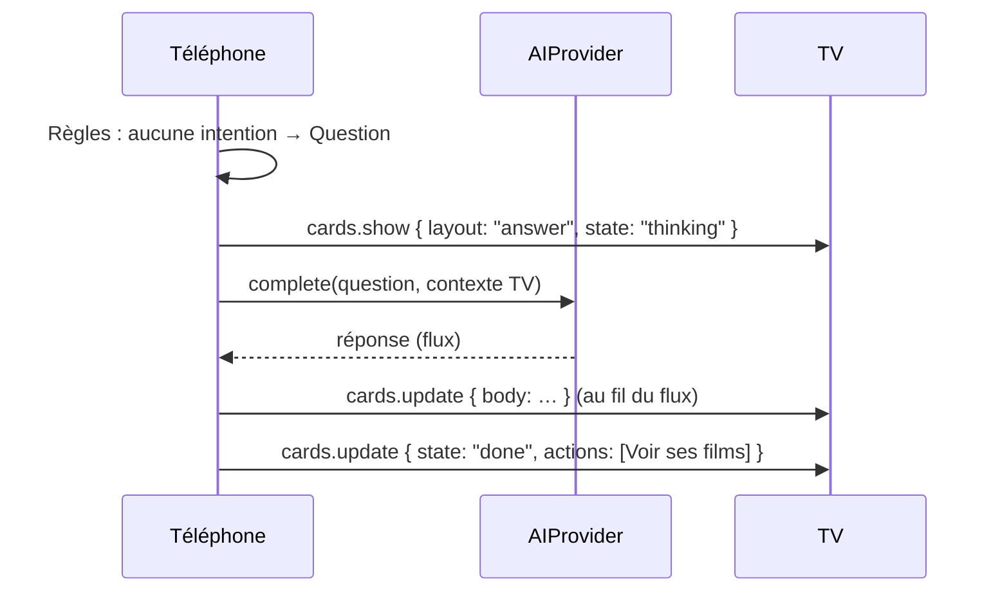
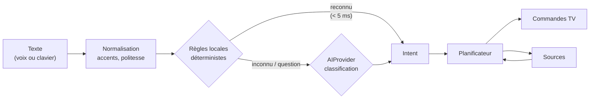
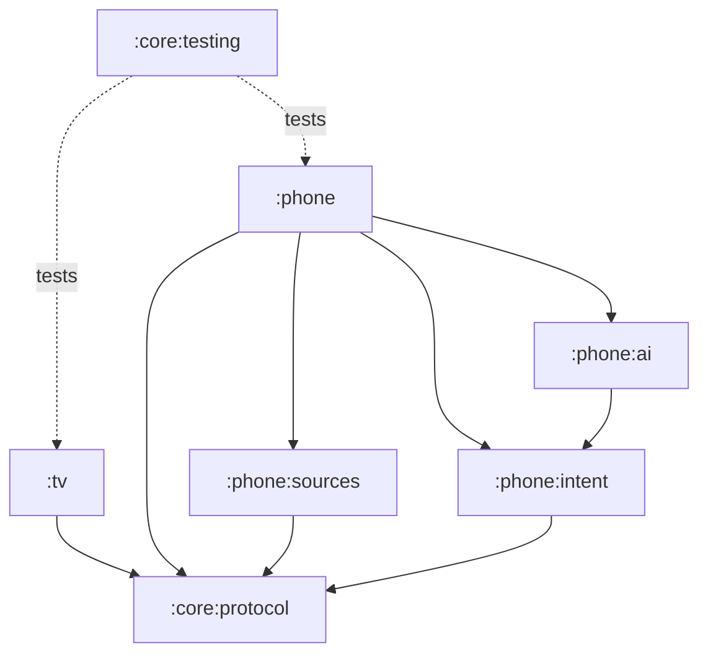

# Architecture HomeHub

> Statut : **référence cible à partir de la V3**. La section [État actuel et migration](#13-état-actuel-et-migration) décrit l'écart avec le code de la V2.

## Sommaire

1. [Principes directeurs](#1-principes-directeurs)
2. [Vue d'ensemble](#2-vue-densemble)
3. [Répartition des responsabilités](#3-répartition-des-responsabilités)
4. [Flux de bout en bout](#4-flux-de-bout-en-bout)
5. [HomeHub TV](#5-homehub-tv)
6. [HomeHub Remote (le cerveau)](#6-homehub-remote-le-cerveau)
7. [Communication : la couche de commandes unique](#7-communication--la-couche-de-commandes-unique)
8. [Modèle de cartes](#8-modèle-de-cartes)
9. [Modules Gradle et règles de dépendance](#9-modules-gradle-et-règles-de-dépendance)
10. [Sécurité](#10-sécurité)
11. [Performances : budgets](#11-performances--budgets)
12. [Qualité et livraison](#12-qualité-et-livraison)
13. [État actuel et migration](#13-état-actuel-et-migration)
14. [Contraintes de la plateforme et risques](#14-contraintes-de-la-plateforme-et-risques)

---

## 1. Principes directeurs

| Principe | Conséquence technique |
|---|---|
| La TV affiche, le téléphone décide ([ADR-0002](adr/0002-ecosysteme-tv-telephone.md)) | La TV n'interprète aucune phrase et n'appelle aucun service Internet. Elle expose une API de commandes et rend des cartes. |
| Une seule couche de commandes ([ADR-0003](adr/0003-protocole-json-rpc-websocket.md)) | Chaque action de la TV, qu'elle vienne du téléphone, de la télécommande physique ou d'une future automatisation, passe par le même `CommandDispatcher`. |
| Tout est une carte ([ADR-0008](adr/0008-interface-en-cartes.md)) | Un schéma `Card` unique, défini dans le protocole, rendu par un seul moteur sur la TV et réutilisé en aperçu sur le téléphone. |
| Fournisseurs interchangeables ([ADR-0005](adr/0005-abstraction-aiprovider.md), [ADR-0007](adr/0007-recherche-universelle.md)) | IA, recherche, météo : interfaces communes, implémentations branchables, choix dans les paramètres du téléphone. |
| Local d'abord, sécurisé ([ADR-0004](adr/0004-appairage-et-securite.md)) | Réseau local uniquement, appairage par code, jetons, secrets jamais présents sur la TV. |
| Protocole contractuel | Le protocole est un module partagé, versionné, documenté, couvert par des tests de contrat (fixtures JSON communes). |

## 2. Vue d'ensemble



## 3. Répartition des responsabilités

| Domaine | HomeHub TV | HomeHub Remote |
|---|---|---|
| Launcher, navigation, animations | ✅ | — |
| Rendu des cartes (réponses, résultats, widgets) | ✅ rend | ✅ construit (et prévisualise) |
| Ouverture d'applications, deep links | ✅ exécute | ✅ décide |
| Télécommande, clavier | ✅ injecte | ✅ capte |
| Reconnaissance vocale | — | ✅ |
| Interprétation des intentions | — | ✅ |
| Appels IA | — | ✅ |
| Appels Internet (métadonnées, météo, web) | — | ✅ |
| Données des widgets | ✅ affiche (cache local) | ✅ produit et pousse |
| Paramètres d'apparence | ✅ | ✅ (paramètres avancés à distance) |
| Secrets (clés API, jetons de services) | ❌ jamais | ✅ chiffrés |
| Automatisations | — | ✅ (V6) |

**Conséquence assumée** : sans téléphone, la TV reste un launcher complet (applications, favoris, récents, paramètres, widgets en cache) piloté par la télécommande physique ; les fonctions intelligentes demandent le téléphone. Le bouton micro de la télécommande physique continue d'ouvrir l'assistant du système.

## 4. Flux de bout en bout

### 4.1 « Lance Netflix » — intention locale, sans Internet



### 4.2 « Recherche Interstellar » — recherche universelle



### 4.3 « Qui est Christopher Nolan ? » — question à l'IA



### 4.4 « Quelle météo demain ? » — widget

Règles → `Weather(date = demain)` → `WeatherSource` (téléphone) → `widgets.update { id: "weather", card: … }` + `cards.show { layout: "focus", widget: "weather" }`.

### 4.5 « Mets une musique relaxante » — musique

Règles → `PlayMusic(query = "musique relaxante", app = préférée)` → `app.open { package: deezer, intent: MEDIA_PLAY_FROM_SEARCH, query }` ; repli : ouverture de l'application et carte « Lecture sur Deezer ».

## 5. HomeHub TV

### 5.1 Couches

```
tv/
├── network/        Serveur WebSocket, sessions, appairage, découverte DNS-SD
├── command/        CommandDispatcher + handlers (une classe par domaine)
├── platform/       Lanceur d'applications, pont d'entrées, accessibilité, audio
├── data/           Repositories locaux (apps, récents, réglages, cache widgets)
├── ui/             Écrans, composants, thème, moteur de cartes
└── di/             Conteneur de dépendances
```

### 5.2 CommandDispatcher : la couche unique

Toute action passe par une seule porte d'entrée typée :

```kotlin
sealed interface TvCommand {
    data class LaunchApp(val packageName: String, val uri: String? = null) : TvCommand
    data class ShowCards(val surface: CardSurface) : TvCommand          // displayAnswer, résultats…
    data class UpdateCard(val surfaceId: String, val patch: CardPatch) : TvCommand
    data class UpdateWidget(val widget: WidgetState) : TvCommand
    data class ShowNotification(val notification: Notification) : TvCommand
    data class Input(val key: RemoteKey) : TvCommand
    data class Text(val text: String) : TvCommand
    data class Navigate(val destination: Destination) : TvCommand
    // …
}

interface CommandDispatcher {
    suspend fun dispatch(command: TvCommand, origin: Origin): CommandResult
}
```

- Le serveur réseau traduit chaque méthode JSON-RPC en `TvCommand`, rien d'autre.
- L'interface locale (clic sur une carte, télécommande physique) émet les mêmes commandes avec `Origin.Local`.
- Le dispatcher applique les règles transverses : autorisation (session appairée), journalisation, limitation de débit, mesure de latence.
- Un handler par domaine (`AppHandler`, `CardHandler`, `WidgetHandler`, `InputHandler`, `NotificationHandler`, `NavigationHandler`) : ajout d'une commande = un cas + un handler, sans toucher au réseau.

### 5.3 Rendu

- **Launcher** : l'accueil est une liste ordonnée de modules (`HomeModule`) — favoris, récents, widgets, et demain plugins.
- **Moteur de cartes** : un composant `CardView` par type de carte, un conteneur par `layout` (`answer`, `results`, `focus`, `loading`). Les cartes arrivent en données, jamais en code.
- **Superpositions** : toasts, notifications, panneau de réponse IA — au-dessus de l'écran courant ou d'une autre application (fenêtre de superposition, V4).

### 5.4 Contraintes de légèreté

- Pas de bibliothèque d'images réseau : les images de cartes sont envoyées par le téléphone (redimensionnées, ≤ 60 Ko) ou référencées en URL HTTPS téléchargée une fois et mise en cache disque.
- Pas d'injection de dépendances par framework : conteneur manuel.
- Budget APK TV : < 3 Mo.

## 6. HomeHub Remote (le cerveau)

### 6.1 Couches

```
phone/
├── session/        Client WebSocket, découverte, appairage, reconnexion
├── voice/          Reconnaissance vocale
├── intent/         Moteur d'intentions (module :phone:intent, Kotlin pur)
├── planner/        Intention → suite de commandes TV
├── ai/             AIProvider + registre (module :phone:ai)
├── sources/        Recherche, météo, Plex… (module :phone:sources)
├── secrets/        Coffre chiffré (Android Keystore)
├── ui/             Télécommande, clavier, applis, paramètres avancés, aperçu des cartes
└── di/
```

### 6.2 Pipeline d'intention



- **Règles d'abord** ([ADR-0006](adr/0006-moteur-intentions-hybride.md)) : rapides, hors ligne, testables, gratuites. Elles couvrent les intentions courantes (lancer, chercher, lecture, volume, navigation, météo, musique).
- **IA ensuite** : pour les questions ouvertes et les phrases que les règles ne comprennent pas. L'IA renvoie une intention structurée (JSON validé) ou une réponse textuelle.
- **Intents** : `LaunchApp`, `UniversalSearch`, `PlayMedia`, `PlayMusic`, `MediaControl`, `Volume`, `Navigate`, `TypeText`, `Weather`, `Question`, `Unknown`.

### 6.3 AIProvider

```kotlin
interface AIProvider {
    val id: String                       // "demo", "openai", "anthropic", "gemini", "local"
    val displayName: String
    val capabilities: Set<AICapability>  // CHAT, STREAMING, INTENT_CLASSIFICATION, VISION…
    suspend fun complete(request: AIRequest): AIResponse
    fun stream(request: AIRequest): Flow<AIChunk>
    suspend fun classify(text: String, context: IntentContext): IntentCandidate?
}
```

Implémentations : `DemoProvider` en V4 (hors ligne, réponses scénarisées, pour tester toute la chaîne sans clé), puis OpenAI, Anthropic, Gemini et modèle local. Détails : [ADR-0005](adr/0005-abstraction-aiprovider.md).

## 7. Communication : la couche de commandes unique

- **Transport** : WebSocket sur le réseau local, `ws://<tv>:8765/homehub`.
- **Format** : JSON-RPC 2.0 — requêtes (avec `id`), réponses, notifications (sans `id`) dans les deux sens.
- **Méthodes** nommées `domaine.action` : `app.launch`, `cards.show`, `widgets.update`, `notifications.show`, `input.key`…
- **Événements** TV → téléphone : `card.action`, `session.status`, `tv.foregroundChanged`…
- **Version** négociée à l'ouverture (`session.hello`), compatibilité ascendante obligatoire au sein d'une version majeure.

Spécification complète : [API locale](api/local-api.md).

Correspondance avec les commandes du cahier des charges :

| Commande | Méthode | Handler TV |
|---|---|---|
| `launchApp()` | `app.launch` | `AppHandler` |
| `search()` | `cards.show` (layout `results`) | `CardHandler` |
| `displayAnswer()` | `cards.show` (layout `answer`) + `cards.update` | `CardHandler` |
| `playMusic()` | `app.open` (intention de lecture) | `AppHandler` |
| `showNotification()` | `notifications.show` | `NotificationHandler` |
| `updateWidget()` | `widgets.update` | `WidgetHandler` |

## 8. Modèle de cartes

Une carte est une donnée sérialisable ([ADR-0008](adr/0008-interface-en-cartes.md)) :

```json
{
  "id": "tmdb:157336",
  "kind": "video",
  "title": "Interstellar",
  "subtitle": "2014 · Science-fiction · 2 h 49",
  "body": "Des explorateurs utilisent une faille spatio-temporelle…",
  "image": { "url": "https://image.tmdb.org/t/p/w342/…", "ratio": "2:3" },
  "badges": ["Netflix", "Prime Video"],
  "actions": [
    { "id": "open", "label": "Regarder sur Netflix", "command": { "method": "app.open", "params": { "package": "com.netflix.ninja" } } }
  ]
}
```

Types (`kind`) : `answer`, `web`, `video`, `music`, `app`, `person`, `weather`, `widget`, `notification`. Un type inconnu de la TV est rendu par la carte générique (titre, sous-titre, image, texte) : le téléphone peut évoluer plus vite que la TV.

## 9. Modules Gradle et règles de dépendance

Cible ([ADR-0009](adr/0009-modularisation.md)) :

```
:core:protocol      Kotlin/JVM pur — messages JSON-RPC, méthodes, cartes, codec (kotlinx.serialization)
:core:testing       Fixtures de contrat partagées (JSON d'exemple de l'API)
:tv                 Application Android TV (com.homehub.launcher)
:phone              Application téléphone (com.homehub.remote)
:phone:intent       Kotlin/JVM pur — normalisation, règles, intents
:phone:ai           AIProvider, registre, DemoProvider (+ fournisseurs réels)
:phone:sources      Recherche universelle, météo, Plex…
```



Règles :
- `:tv` ne dépend jamais d'un module `:phone:*`.
- Les modules `:core:*` et `:phone:intent` sont du Kotlin pur (testables sur JVM, sans émulateur).
- Aucune dépendance circulaire ; un module de fonctionnalité ne dépend pas d'un autre module de fonctionnalité.

## 10. Sécurité

| Menace | Mesure |
|---|---|
| Un appareil du Wi-Fi prend le contrôle de la TV | Appairage par code affiché à l'écran, uniquement quand le panneau est ouvert ; 5 essais par code ; jeton 256 bits par téléphone, la TV n'en garde que l'empreinte SHA-256 ; révocation depuis la TV. |
| Écoute du trafic local | V2–V6 : trafic en clair sur le LAN (commandes sans données sensibles). V7 : TLS avec certificat auto-signé épinglé lors de l'appairage ([ADR-0004](adr/0004-appairage-et-securite.md)). |
| Fuite de clés d'API | Clés uniquement sur le téléphone, chiffrées (Android Keystore), jamais envoyées à la TV ni journalisées. |
| Injection via le contenu des cartes | La TV rend du texte, jamais de HTML ni de code ; les actions de cartes ne peuvent appeler que les méthodes de l'API publique. |
| Abus du service d'accessibilité | Activé explicitement par l'utilisateur ; lecture de l'écran uniquement au moment d'une commande ; aucune donnée lue n'est transmise ([ADR-0011](adr/0011-injection-entrees-accessibilite.md)). |
| Déni de service local | Taille de message bornée, limitation de débit par session, sessions inactives fermées. |

## 11. Performances : budgets

| Mesure | Budget | Où |
|---|---|---|
| Démarrage à froid de l'accueil (Mi Box) | < 800 ms | TV |
| Temps d'image en navigation | < 16 ms (60 fps) | TV |
| Mémoire en usage normal | < 120 Mo | TV |
| Taille APK | < 3 Mo TV · < 8 Mo téléphone | CI |
| Touche téléphone → effet TV | < 80 ms (Wi-Fi) | Bout en bout |
| Fin de phrase → action (intention locale) | < 1,5 s | Bout en bout |
| Fin de phrase → première ligne de réponse IA | < 3 s | Bout en bout |
| Recherche universelle : premiers résultats | < 1,5 s ; complète < 2,5 s | Téléphone |

Règles d'implémentation TV : animations lues en phase de dessin (aucune recomposition par image), images pré-décodées et plafonnées, aucun travail sur le thread principal hors rendu, flux arrêtés quand l'écran n'est pas visible.

## 12. Qualité et livraison

- **Tests** : unitaires JVM pour le protocole, le moteur d'intentions et les règles ; tests de contrat sur les fixtures JSON de l'API (même fichier lu par la TV et le téléphone) ; tests d'interface Compose ciblés à partir de la V5.
- **Analyse statique** : ktlint + detekt en CI (V3).
- **Workflow Git** ([ADR-0010](adr/0010-workflow-git-et-versionnage.md)) : une branche par fonctionnalité, pull request, CI verte obligatoire, fusion dans `main`, release automatique.
- **Versionnage** : `0.x` jusqu'à la V10 qui publie `1.0.0` ; numéros de build = numéro de run CI.

## 13. État actuel et migration

| Sujet | V2 (actuel) | Cible | Migration |
|---|---|---|---|
| Transport | TCP, une ligne JSON par message | WebSocket + JSON-RPC 2.0 | V3 : serveur v2 en parallèle du v1, téléphone en v2, retrait du v1 en V4 |
| Interprétation vocale | Sur la TV (`VoiceCommandInterpreter`) | Sur le téléphone (`:phone:intent`) | V3 : déplacement du code et de ses tests ; la TV ne reçoit plus que des commandes |
| Modules | `:app`, `:remote`, `:protocol` (Android, org.json) | `:tv`, `:phone`, `:core:protocol` (JVM, kotlinx.serialization)… | V3 : renommage des dossiers ; les `applicationId` ne changent pas (mises à jour transparentes) |
| Rendu de réponses | Bandeau de confirmation | Moteur de cartes | V3 (résultats) puis V4 (réponses IA) |
| Versions | TV `1.1.0`, téléphone `1.0.0` | `0.3.0` à la V3 | Les `versionCode` restent croissants : aucune désinstallation nécessaire |

## 14. Contraintes de la plateforme et risques

| Contrainte / risque | Impact | Réponse |
|---|---|---|
| Android < 13 n'offre pas d'injection native du pavé directionnel | Navigation à distance limitée dans certaines applications | Accessibilité (focus) + télécommande physique ; natif dès Android 13 ([ADR-0011](adr/0011-injection-entrees-accessibilite.md)) |
| Google TV impose son écran d'accueil sur le bouton Home | HomeHub ne peut pas être l'accueil par défaut sur ces appareils | Remappage (Button Mapper) documenté ; la valeur de HomeHub ne dépend pas du rôle « Home » |
| Netflix, Prime Video n'ont pas d'API publique de recherche | Recherche universelle par métadonnées tierces | TMDB (fournisseurs de streaming par pays) + recherche dans l'application ([ADR-0007](adr/0007-recherche-universelle.md)) |
| Politique Play Store sur l'API d'accessibilité | Publication soumise à déclaration et justification | Fonction optionnelle, divulgation explicite ; variante Play sans accessibilité si refus |
| Clés d'API tierces (TMDB, YouTube, IA) | Quotas, coûts, conditions d'utilisation | Clés fournies par l'utilisateur ou clé de démonstration à quota limité ; sources désactivables |
