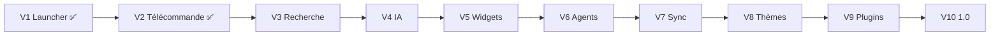

# Roadmap HomeHub

Chaque version est une étape **utilisable** : elle se termine par une release publiée, testée sur la Mi Box, avec changelog et documentation à jour.
Versionnage ([ADR-0010](adr/0010-workflow-git-et-versionnage.md)) : la version `Vn` publie `0.n.0` ; la V10 publie `1.0.0`.

| Version | Thème | Statut | Release |
|---|---|---|---|
| V1 | Launcher | ✅ Livrée | 0.1.0 (publiée sous le nom 1.0.0) |
| V2 | Télécommande | ✅ Livrée | 0.2.0 (publiée sous le nom 1.1.0, build 5) |
| V3 | Recherche universelle | 🚧 En cours (lots 3.1–3.2 livrés) | 0.3.0 |
| V4 | IA | Planifiée | 0.4.0 |
| V5 | Widgets | Planifiée | 0.5.0 |
| V6 | Agents spécialisés | Planifiée | 0.6.0 |
| V7 | Synchronisation multi-appareils | Planifiée | 0.7.0 |
| V8 | Marketplace de thèmes | Planifiée | 0.8.0 |
| V9 | Plugins | Planifiée | 0.9.0 |
| V10 | Version stable | Planifiée | 1.0.0 |

---

## V1 — Launcher ✅

**Objectif** : remplacer l'écran d'accueil par une interface premium et fluide.

Livré : launcher `HOME`/`LEANBACK_LAUNCHER`, barre d'état (heure, date, réseau), favoris (Netflix, YouTube, Deezer, Plex, Prime Video, Paramètres, Toutes les applications), récents, focus lumineux, fond animé, paramètres persistants (accent, fond, taille des cartes), CI GitHub Actions.

## V2 — Télécommande ✅

**Objectif** : piloter la TV depuis le téléphone.

Livré : HomeHub Remote (découverte mDNS, appairage par code + QR, pavé directionnel, lecture, volume, applications avec icônes, clavier en direct, micro intégré avec transcription), contrôle complet par accessibilité, commandes vocales françaises, release « latest » à téléchargement direct.

Dette connue reprise en V3 : interprétation vocale sur la TV, protocole TCP maison.

## V3 — Recherche universelle 🔜

**Objectif** : « Recherche Interstellar » affiche, sur la TV, des cartes de résultats provenant de plusieurs services, et ouvre le bon contenu dans la bonne application.

### Lot 3.1 — Fondations ✅ (0.3.0-alpha.1)
- ✅ Modules `:tv`, `:phone`, `:core:protocol` (Kotlin pur, kotlinx.serialization) — [ADR-0009](adr/0009-modularisation.md)
- ✅ Protocole v2 : JSON-RPC 2.0 sur WebSocket (Java-WebSocket / OkHttp), v1 retiré — [ADR-0003](adr/0003-protocole-json-rpc-websocket.md)
- ✅ `CommandDispatcher` unique sur la TV, handlers par domaine ; l'interface locale l'utilise aussi
- ✅ Fixtures de contrat + tests ; contrôle de taille des APK en CI ; version unique dans `gradle.properties`
- ⏳ Lot 3.1b : ktlint + detekt en CI

### Lot 3.2 — Moteur d'intentions sur le téléphone ✅ (0.3.0-alpha.1)
- ✅ Module `:phone:intent` : normalisation, règles, `UserIntent` typés — [ADR-0006](adr/0006-moteur-intentions-hybride.md)
- ✅ Grammaire V2 et ses tests déplacés depuis la TV ; planificateur `IntentExecutor` sur le téléphone
- 🔄 Corpus : 69 phrases mesurées à chaque build (seuil 95 %) ; objectif 200 phrases d'ici la sortie de la V3

### Lot 3.3 — Sources de recherche
- Interface `SearchSource` — [ADR-0007](adr/0007-recherche-universelle.md)
- `TmdbSource` (films, séries, personnes, fournisseurs de streaming FR), `YouTubeSource`, `PlexSource` (serveur local), `InstalledAppsSource`
- Agrégation parallèle avec délai maximal, déduplication, classement
- Écran de configuration des sources et des clés sur le téléphone (coffre chiffré)

### Lot 3.4 — Cartes sur la TV
- Moteur de cartes (`results`, `focus`, `loading`), carte générique, `video`, `person`, `app` — [ADR-0008](adr/0008-interface-en-cartes.md)
- Ouverture d'un résultat : deep link quand il existe, sinon recherche dans l'application, sinon ouverture simple
- Aperçu des mêmes cartes sur le téléphone

**Critères de sortie** : « Recherche Interstellar » affiche des résultats en < 2,5 s ; ouverture correcte sur Netflix/Prime/YouTube/Plex quand le contenu y est ; > 85 % du corpus compris sans IA ; protocole v2 documenté et couvert par tests de contrat ; TV toujours < 3 Mo.

## V4 — IA

**Objectif** : poser une question à la TV et obtenir une réponse en carte, avec le fournisseur d'IA de son choix.

- Module `:phone:ai`, interface `AIProvider`, registre, sélection dans les paramètres — [ADR-0005](adr/0005-abstraction-aiprovider.md)
- `DemoProvider` hors ligne (réponses scénarisées) : chaîne complète testable sans clé
- Première implémentation réelle derrière la même interface (fournisseur choisi par l'utilisateur, clé personnelle)
- Classification par IA des phrases non comprises par les règles (sortie JSON validée)
- Panneau de réponse sur la TV, affichage en flux (`cards.update` + `bodyAppend`), actions de suivi (« Voir ses films »)
- Contexte transmis à l'IA : application au premier plan, dernière recherche (opt-in)

**Critères de sortie** : première ligne de réponse < 3 s ; changement de fournisseur sans redémarrage ; aucune clé hors du téléphone (vérifié par revue et test).

## V5 — Widgets

**Objectif** : un accueil vivant (météo, agenda, lecture en cours) sans alourdir la TV.

- Hôte de widgets dans le launcher (module d'accueil `Widgets`), cache local, expiration
- Producteurs côté téléphone : météo (« Quelle météo demain ? »), agenda Google, lecture en cours (Deezer/Spotify), horloges
- Planification des mises à jour (WorkManager), uniquement quand la TV est allumée
- Tests d'interface Compose sur l'accueil

**Critères de sortie** : widgets lisibles sans téléphone (cache), aucune régression du démarrage à froid.

## V6 — Agents spécialisés

**Objectif** : des assistants spécialisés qui enchaînent plusieurs actions.

- Agent Cinéma (recommandations selon les services disponibles), Musique, Maison connectée (Home Assistant), Médias locaux (NAS/Plex)
- Outils exposés aux agents = méthodes de l'API locale (l'agent ne fait rien que l'utilisateur ne puisse faire)
- Automatisations simples (« à 20 h, ouvre Plex ») et routines
- Garde-fous : confirmation pour les actions sensibles, journal des actions

## V7 — Synchronisation multi-appareils

**Objectif** : plusieurs téléphones, plusieurs TV, une seule configuration.

- Plusieurs TV dans le téléphone, bascule instantanée
- Synchronisation chiffrée de bout en bout des réglages (stockage au choix de l'utilisateur : Google Drive, WebDAV, fichier)
- TLS sur le réseau local avec certificat épinglé à l'appairage — [ADR-0004](adr/0004-appairage-et-securite.md)
- Gestion des téléphones appairés (nommer, révoquer un par un)

## V8 — Marketplace de thèmes

**Objectif** : changer complètement l'apparence de HomeHub.

- Format de thème déclaratif (couleurs, typographies, formes, fonds animés paramétrés, disposition de l'accueil), versionné et validé
- Galerie de thèmes (index statique sur GitHub), installation depuis le téléphone, aperçu en direct sur la TV
- Éditeur de thème sur le téléphone

## V9 — Plugins

**Objectif** : permettre à des tiers d'étendre HomeHub sans modifier son code.

- SDK HomeHub : sources de recherche, widgets, intentions, agents
- Modèle d'exécution sûr (plugins côté téléphone, permissions déclarées, bac à sable)
- Les plugins TV se limitent à des cartes et widgets déclaratifs
- Documentation SDK, plugin d'exemple, registre

## V10 — Version stable 1.0

**Objectif** : publication sur le Play Store.

- Gel du protocole v2 (compatibilité garantie), audit de sécurité, audit d'accessibilité
- Performances mesurées sur Mi Box et sur un appareil Google TV récent
- Conformité Play Store (déclaration d'accessibilité, politique de confidentialité, formulaire sécurité des données)
- Localisation anglaise, site de documentation, procédure de contribution
- Plan de maintenance (versions LTS, fenêtre de compatibilité Android)

---

## Hors périmètre (toutes versions)

- Contournement de DRM ou des restrictions des services de streaming
- Serveur cloud HomeHub, comptes utilisateurs HomeHub
- Modèle d'IA exécuté sur la TV
